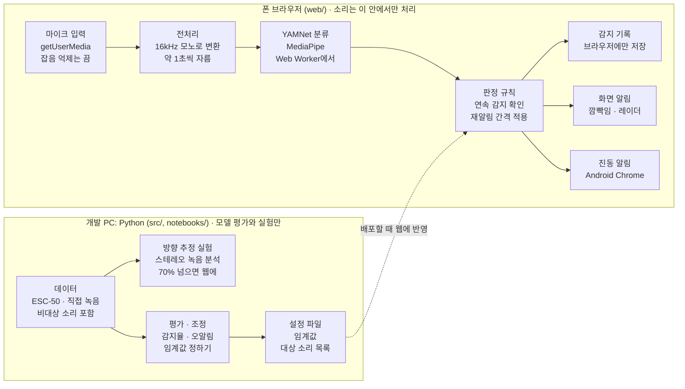

# 소리결 프로젝트 기획서

2026-11-16 작성 · 2026-11-20 수정 · 하민, 심준형

소리결은 청각장애인·난청인이 화면을 보지 않아도 위험한 소리를 알아차리도록 돕는 모바일 웹 앱이다. 2명이 4주(11/17~12/14) 동안 위험한 소리(1차: 사이렌·경적)를 브라우저 안에서 감지해 진동과 화면으로 알리는 MVP를 만든다.

**11/20 수정**: 1차 범위를 소리 4종에서 사이렌·경적·배경 3클래스로 줄였고, 분류 모델을 'YAMNet 라벨 그대로'에서 'YAMNet 임베딩 위 작은 분류기(한국 데이터로 학습)'로 바꿨다. 이유는 5장 표에 적었다.

## 1. 프로젝트 개요

| 항목 | 내용 |
| --- | --- |
| 프로젝트 이름 | 소리결 (SoriGyeol) |
| 한 줄 소개 | 들리지 않는 주변 소리를 진동과 화면으로 알려 주는 웹 앱 |
| 기간 | 2026.11.17 ~ 2026.12.14 (4주) |
| 팀 | 2명: 하민 웹 앱 · 심준형 모델·데이터 |
| 형태 | 모바일 웹 앱 (Android Chrome 우선), PWA |
| 기술 | JavaScript, Web Audio API, MediaPipe(YAMNet) / Python 3.11, PyTorch, librosa |
| 레포 | [github.com/simpson92/SoriGyeol](https://github.com/simpson92/SoriGyeol) |
| 목적 | 취업 포트폴리오 |

역할을 바꾸면 7장 일정도 함께 고친다.

## 2. 문제 정의

청각장애인·난청인은 경적, 사이렌, 화재경보처럼 위험을 알리는 소리를 놓치기 쉽다. 소리를 화면에 보여 주는 것만으로는 부족하다. 걸으면서 화면을 보면 오히려 장애물과 차량을 놓치기 때문이다.

| 문제 | 지금 상황 | 소리결의 접근 |
| --- | --- | --- |
| 위험한 소리를 못 듣는다 | 주변 사람이나 시각 정보에 의존 | 사이렌·경적을 자동으로 감지해 알림 (1차) |
| 화면 알림은 보행 중에 위험하다 | 알림을 보려면 화면을 봐야 함 | 이동 중에는 진동 패턴만으로 알림 |
| 모든 소리를 알리면 지친다 | 오알림이 많으면 알림을 끄게 됨 | 긴급한 소리만 골라 긴급도별로 구분 |

기존 기능(Android 소리 알림, iPhone 소리 인식)과의 비교는 1주차에 직접 써 본 뒤 채운다. [비교 결과]

### 대상 사용자

| 사용자 | 상황 | 필요한 것 |
| --- | --- | --- |
| 걸어서 이동하는 청각장애인·난청인 | 도로, 횡단보도, 주차장 | 경적·사이렌을 화면을 보지 않고 바로 알아차림 |
| 집에 있는 청각장애인·난청인 | 혼자 있거나 다른 일을 하는 중 | 초인종·노크·화재경보 알림 (1차 이후 후보) |

당사자 인터뷰나 피드백을 받으면 이 표를 보완한다. [협조 기관 또는 인터뷰 대상]

## 3. 해결 방법

폰 브라우저가 마이크로 주변 소리를 듣고, 약 1초마다 소리 종류를 판단한다. 긴급한 소리면 진동과 화면으로 알린다. 소리는 브라우저 밖으로 나가지 않는다.

### 핵심 기능

| 기능 | 내용 |
| --- | --- |
| 소리 감지·분류 | 1차: 사이렌·자동차 경적을 배경 소리와 구분(3클래스). 화재경보는 만들어 두고 꺼 둠, 초인종·노크는 이후 후보 |
| 오알림 방지 | 연속으로 감지될 때만 확정하고, 같은 소리는 일정 시간 다시 알리지 않음 |
| 진동 알림 | 긴급(길게 3회)과 일반(짧게 2회) 2종. Android Chrome |
| 화면 알림 | 화면 전체를 색으로 깜빡이고 소리 이름을 크게 표시. iPhone에서는 진동 대신 사용 |
| 이동·정지 모드 | 걸을 때는 진동 위주, 멈추면 레이더 화면에 자세히 표시 |
| 감지 기록·설정 | 최근 감지 목록, 알림을 받을 소리 선택, 진동 세기 |
| 방향 추정 (실험) | 녹음 파일로 좌/우 추정을 실험하고, 기준을 넘으면 앱에 탑재 |

### 범위

| 이번에 하는 것 (MVP) | 이번에 안 하는 것 |
| --- | --- |
| 사이렌·경적 감지·분류 (사이렌·경적·배경 3클래스) | 말소리 인식, 자막 변환 |
| 진동·화면 알림 | 네이티브 앱 (Android Studio·Xcode) |
| 레이더 화면, 감지 기록, 설정 | 스마트워치·스마트 글래스 연동 |
| 방향 추정 실험 (좌/우) | 로그인, 서버 저장 |
| 실내·실외 현장 테스트 | 화면이 꺼진 상태에서의 감지 |
| 한국 도시 소리 데이터로 분류기 학습·평가 | 화재경보·초인종·노크 (1차 이후 후보) |

## 4. 시스템 구성

소리는 폰 브라우저 밖으로 나가지 않는다.

Python에서 정한 임계값과 대상 소리 목록은 설정 파일로 웹 앱에 넣는다. 방향 추정은 실험 결과가 기준을 넘을 때만 웹으로 옮긴다.

## 5. 기술적 의사결정

가장 큰 결정은 네이티브 앱 대신 웹 앱을 고른 것이다. 설치 없이 링크로 시연할 수 있는 대신, 화면이 꺼지면 감지가 멈추는 제약을 받아들였다.

| 결정 | 고른 것 | 고려한 대안 | 이유 |
| --- | --- | --- | --- |
| 앱 형태 | 모바일 웹 앱 | Android 네이티브 앱 | 링크만으로 시연할 수 있고, 2명이 4주 안에 끝낼 수 있음. 화면이 꺼지면 감지가 멈추고 iPhone은 진동이 안 되는 제약을 받아들임 |
| 분류 위치 | 브라우저 안 | 서버로 소리 전송 | 소리를 밖으로 보내지 않아 개인정보를 지키고, 서버 비용 없이 오프라인으로도 동작 |
| 분류 모델 | YAMNet 임베딩 위 작은 분류기 (한국 데이터로 학습) | YAMNet 라벨 그대로 / 자체 CNN | 웹에서 YAMNet 임베딩 1024개를 꺼낼 수 있음을 확인(11/20). 학습이 몇 분이면 끝나고 웹에 붙이기 쉬움. 자체 CNN은 같은 한국 테스트셋에서 비교 실험으로 진행 |
| 1차 대상 소리 | 사이렌·경적 + 배경 (3클래스) | 4종 (화재경보, 초인종·노크 포함) | 4주 안에 한국 데이터와 테스트셋이 충분한 소리부터 확실히 만듦. 화재경보는 데이터가 부족해(ESC-50 40개, AI Hub 없음) 꺼 둠 |
| 학습·평가 데이터 | AI Hub 도시 소리 + ESC-50 + UrbanSound8K, 한국 테스트셋 3,044개 | 공개 해외 데이터만 사용 | 한국 사이렌·경적은 해외 소리와 달라 한국 데이터로 평가해야 실제 성능을 알 수 있음. 같은 녹음이 학습·테스트에 섞이지 않게 원본 단위로 나눔 |
| 알림 기준 | 연속 감지 + 재알림 간격 | 한 번 감지되면 바로 알림 | 오알림이 많으면 사용자가 알림을 꺼 버림 |
| 방향 추정 | Python 실험으로 분리 | 처음부터 앱에 탑재 | 폰 마이크로는 정확도가 불확실함. 실패해도 핵심 기능에 영향이 없게 분리 |
| 진동 패턴 | 2종으로 시작 | 소리·방향마다 다른 패턴 | 패턴이 많으면 외우기 어려움 |

진행하면서 결정이 생길 때마다 이 표에 한 줄씩 더한다. 면접에서 '왜 그렇게 했나'를 물었을 때 바로 답할 수 있다.

## 6. 성공 기준

4주차에 아래 표로 성공 여부를 판정하고, 결과를 포트폴리오에 숫자로 남긴다. 목표값은 제안값이고, 1주차 실험 뒤 확정한다.

| 지표 | 목표 | 측정 방법 | 결과 |
| --- | --- | --- | --- |
| 감지율 (조용한 실내) | 90% 이상 | 소리별 20회 재생, 감지된 횟수 | [ ] |
| 감지율 (소음 환경) | 70% 이상 | 카페·도로변에서 같은 방식 | [ ] |
| 오알림 | 시간당 1회 이하 | 대상 소리 없이 1시간 켜 두기 | [ ] |
| 감지 지연 | 2초 이내 | 소리가 시작된 때부터 알림까지 | [ ] |
| 방향 정확도 (좌/우) | 70% 이상이면 앱에 탑재 | 4방향 녹음 실험 | [ ] |
| 배터리 | 1시간에 [ ]% 이하 | 화면을 켜 둔 채 1시간 실행 | [ ] |
| 분류 성능 (한국 테스트셋 3,044개) | YAMNet 라벨 그대로보다 높음 | 클래스별 재현율·정밀도를 라벨 그대로·작은 분류기·자체 CNN으로 비교 | [ ] |

## 7. 일정과 역할

2주차 끝에 MVP가 나오고, 4주차에 성능을 숫자로 판정한다.

| | 1주차 · 기반 (11/17–11/23) | 2주차 · 분류·알림 (11/24–11/30) | 3주차 · 화면·방향 (12/1–12/7) | 4주차 · 테스트 (12/8–12/14) |
| --- | --- | --- | --- | --- |
| **웹 앱** (하민) | 레포·화면 기본 틀, 마이크·음량 표시, HTTPS 배포 | MediaPipe YAMNet, Web Worker 분리, 진동·화면 알림 | 레이더·기록 화면, 설정 화면, 화면 켜짐 유지 | 이동·정지 판단, PWA 오프라인, 버그 수정 |
| **모델·데이터** (심준형) | ESC-50 정리·녹음, 스펙트로그램 비교, 대상 소리 확정 | YAMNet 성능 평가, 임계값 정하기, 연속 감지 규칙 | 스테레오 녹음, 4방향 정확도, 탑재 여부 결정 | 현장 테스트, 성능 리포트, README·데모 영상 |
| **주말 점검** | 11/23: 폰 브라우저에서 소리 크기가 보인다 | **11/30 MVP**: 사이렌을 틀면 알림이 온다 | 12/7: 방향 기능 탑재 여부 결정 | 12/14 완료: 성공 기준 판정, 데모 영상 공개 |

매주 일요일에 점검 기준을 확인한다. 3주차 방향 실험이 기준에 못 미쳐도 4주차는 그대로 진행하고, 실험 결과는 리포트에 남긴다.

## 8. 위험 요소와 대응

| 위험 | 대응 |
| --- | --- |
| 화면이 꺼지거나 다른 앱으로 전환하면 마이크가 멈춤 | 감지 중에는 화면 켜짐 유지(Wake Lock). 감지가 멈추면 돌아왔을 때 바로 표시하고, 사용 안내에도 적음 |
| iPhone Safari는 웹 진동을 지원하지 않음 | Android Chrome을 우선 대상으로 하고, iPhone은 화면 전체 깜빡임으로 대체 |
| 브라우저 잡음 억제가 사이렌·경적을 지움 | 마이크를 켤 때 에코 제거·잡음 억제·자동 음량 조절을 끔 |
| 분류 계산 때문에 화면이 버벅임 | 분류를 Web Worker에서 실행 |
| 폰 마이크만으로는 방향 추정이 어려움 | 실험으로 분리하고, 실패하면 결과와 원인을 정리해 포트폴리오에 남김 |
| 소음 환경에서 오알림이 많음 | 연속 감지 규칙을 두고, 말소리·TV 같은 비대상 소리도 모아 임계값을 조정 |
| 당사자 테스트 섭외가 늦어짐 | 1주차에 문의를 시작하고, 안 되면 팀 내부 테스트로 대신한 뒤 한계로 적음 |

## 9. 포트폴리오로 남길 결과물

프로젝트가 끝나면 아래 5가지를 레포에 남긴다. 채용 담당자는 레포의 README와 데모 영상부터 본다.

- [ ] **데모 링크와 영상 (1분)**: 사이렌을 틀었을 때 폰이 진동하는 장면
- [ ] **README**: 문제, 해결 방법, 구성도, 실행 방법, 성과 숫자
- [ ] **성능 평가 리포트**: 6장 표의 결과와 환경별 비교
- [ ] **기술적 의사결정 기록**: 5장 표를 끝까지 이어서 작성
- [ ] **개발 일지** (`docs/devlog.md`): 막혔던 문제와 해결 과정. 면접의 트러블슈팅 질문에 그대로 쓸 수 있음

두 사람이 각자 포트폴리오에 쓸 수 있도록, README에는 누가 무엇을 만들었는지 역할을 나눠 적는다.

## 출처

- [MediaPipe Audio Classifier 웹 가이드](https://developers.google.com/edge/mediapipe/solutions/audio/audio_classifier/web_js)
- [Can I use: navigator.vibrate](https://caniuse.com/mdn-api_navigator_vibrate)
- [WebKit 버그 236509: PWA를 내리면 마이크가 멈춤](https://lists.webkit.org/pipermail/webkit-unassigned/2022-February/1020728.html)
- [soundata: ESC-50 데이터셋 정보와 라이선스](https://soundata.readthedocs.io/en/latest/_modules/soundata/datasets/esc50.html)

> 원본은 Claude 문서로 관리한다. 이 파일은 2026-11-20 기준으로 내보낸 사본이다.
